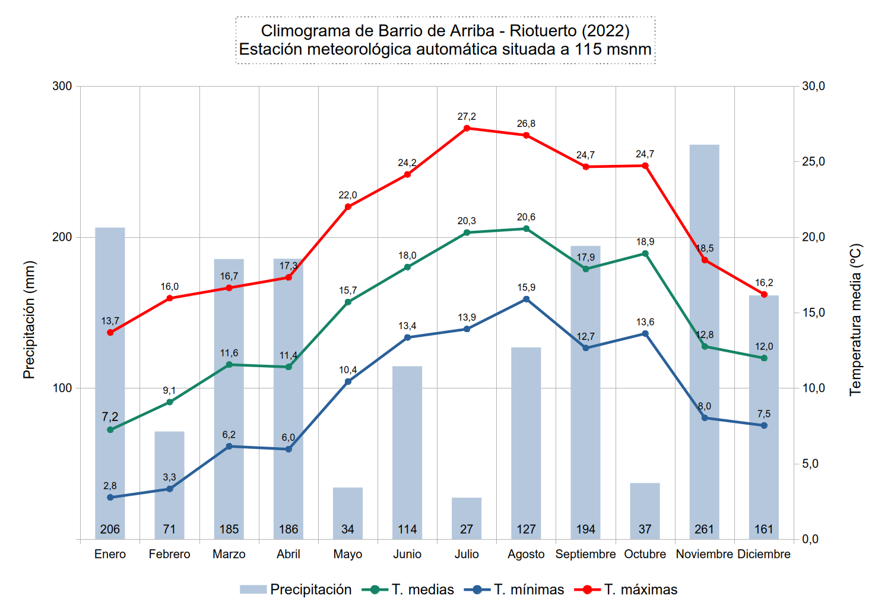
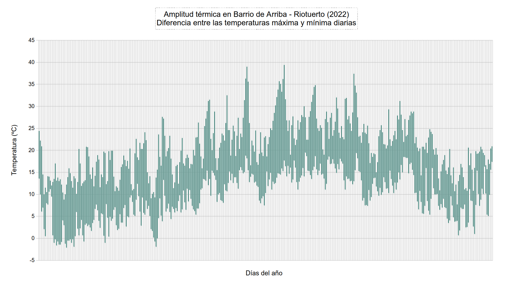
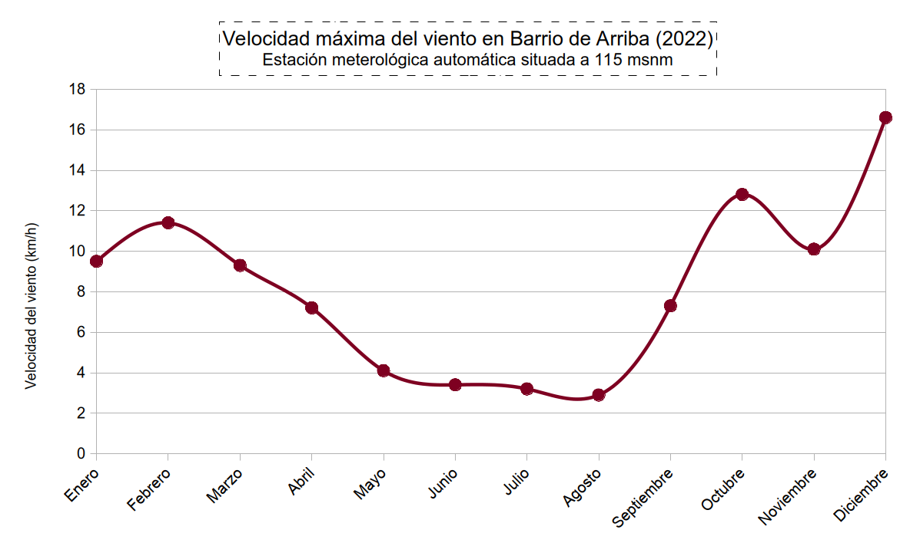

# 📅 Almanaque meteorológico 2022

**Barrio de Arriba, Riotuerto (Cantabria, España)**

## 📝 Descripción sinóptica

El año 2022 en la estación meteorológica automática de Barrio de Arriba (Riotuerto) registra una temperatura media acumulada de **14,7 ºC** y una precipitación total de **1604,8 mm** distribuida en **211 días de lluvia apreciable (≥0,2 mm)**.

* **Temperaturas extremas:** La máxima absoluta alcanzó los **39,4 ºC** (17 de julio), mientras que la mínima absoluta descendió hasta **-2,1 ºC** (23 de enero). No se registraron noches tropicales (la mínima más alta fue de 19,5 ºC el 3 de agosto).
* **Régimen pluviométrico:** El día más lluvioso dejó **67,1 mm** (9 de enero). El mes con mayor precipitación fue **Noviembre** con **261,1 mm**, mientras que el más seco fue **Julio** (27,4 mm).
* **Viento:** La racha máxima registrada fue de **73,4 km/h** (31 de diciembre), con **35 días** con rachas superiores a 40 km/h.

---

## 📊 Galería visual y análisis gráfico

### 1. Dinámica termo-pluviométrica

| Climograma anual | Rango de temperaturas (Máx/Mín) |
| :---: | :---: |
|  |  |

### 2. Régimen de vientos

| Rachas máximas diarias |
| :---: |
|  |

---

## 📈 Ficha estadística anual

| Categoría | Parámetro | Valor | Fecha / Notas |
| :--- | :--- | :--- | :--- |
| **🌡️ Temperaturas** | Media anual | **14,7 ºC** | |
| | Máxima absoluta | **39,4 ºC** | 17 de julio |
| | Mínima absoluta | **-2,1 ºC** | 23 de enero |
| | Media de las máximas | 20,7 ºC | |
| | Media de las mínimas | 9,5 ºC | |
| | Mínima más alta (noche cálida) | 19,5 ºC | 3 de agosto |
| | Mayor oscilación térmica diaria | 24,4 ºC | 11 de septiembre |
| **❄️ Días de Tª** | Heladas (Mín ≤0 ºC) | 20 días | |
| | Noches tropicales (Mín ≥20 ºC) | 0 días | |
| | Noches tórridas o ecuatoriales (Mín ≥25 ºC) | 0 días | |
| | Calor (>30 ºC) | 28 días | |
| | Calor intenso (>35 ºC) | 8 días | |
| | Calor extremo (>40 ºC) | 0 días | |
| **☔ Precipitaciones** | **Acumulado total** | **1604,8 mm** | |
| | Días de lluvia (≥0,2 mm) | 211 días | |
| | Días de lluvia (≥1 mm) | 139 días | |
| | Días de lluvia (≥10 mm) | 49 días | |
| | Días de lluvia (≥30 mm) | 14 días | |
| | Máxima diaria | 67,1 mm | 9 de enero |
| | Mes más lluvioso | Noviembre | 261,1 mm |
| | Mes más seco | Julio | 27,4 mm |
| **💨 Viento** | Velocidad media | 2,6 km/h | |
| | Racha máxima | **73,4 km/h** | 31 de diciembre |
| | Días con rachas ≥40 km/h | 35 días | |
| **☀️ Radiación** | Radiación solar máxima | 1639,8 W/m² | Índice UV máx: 15 |

### Desglose mensual

| Mes | Tª Media (ºC) | Tª Máx (ºC) | Tª Mín (ºC) | Precipitación (mm) | Racha máx (km/h) |
| :--- | :---: | :---: | :---: | :---: | :---: |
| **Enero** | 7,2 | 24,4 | -2,1 | 206,2 | 42,2 |
| **Febrero** | 9,1 | 20,8 | -1,0 | 71,2 | 58,7 |
| **Marzo** | 11,6 | 24,1 | 1,9 | 185,4 | 66,3 |
| **Abril** | 11,4 | 27,6 | -1,9 | 185,6 | 48,0 |
| **Mayo** | 15,7 | 31,5 | 5,4 | 34,1 | 34,9 |
| **Junio** | 18,0 | 39,0 | 8,0 | 114,4 | 31,4 |
| **Julio** | 20,3 | 39,4 | 7,5 | 27,4 | 20,1 |
| **Agosto** | 20,6 | 34,8 | 11,1 | 126,9 | 31,4 |
| **Septiembre** | 17,9 | 37,4 | 7,4 | 194,1 | 40,4 |
| **Octubre** | 18,9 | 31,2 | 9,7 | 37,1 | 64,4 |
| **Noviembre** | 12,8 | 24,8 | 3,5 | 261,1 | 56,8 |
| **Diciembre** | 12,0 | 20,9 | 0,7 | 161,3 | 73,4 |

> *Nota: Los datos proceden de una [estación meteorológica automática](https://app.weathercloud.net/d6619283754) Sainlogic WS3500 emitiendo a través de una puerta de enlace Ecowitt GW1200.
