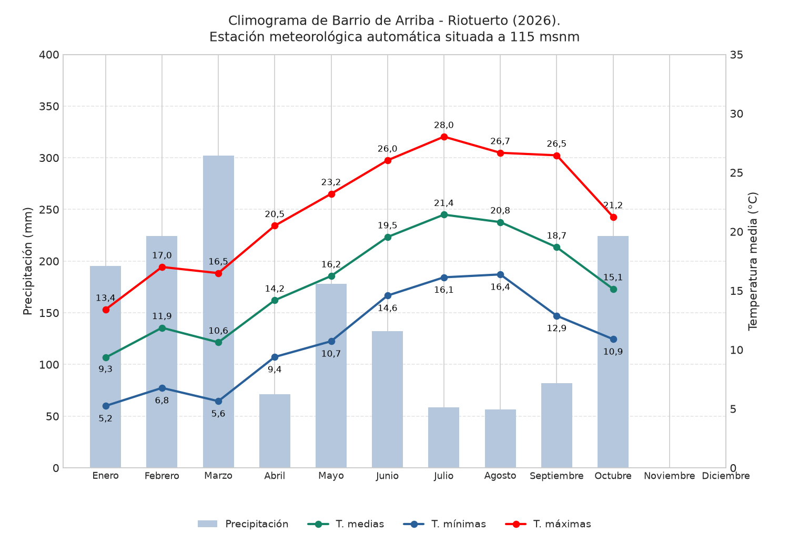
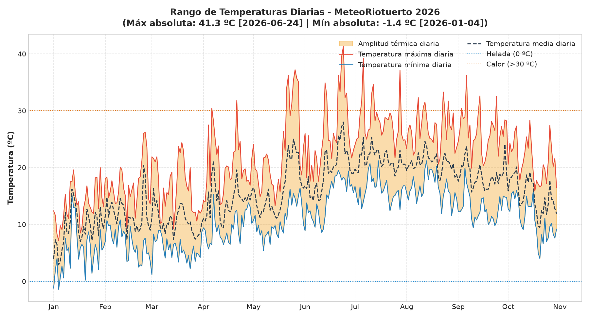
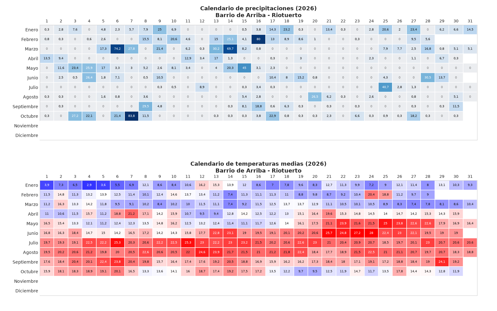
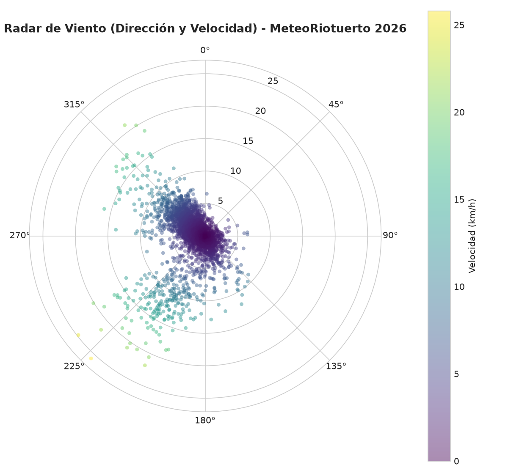
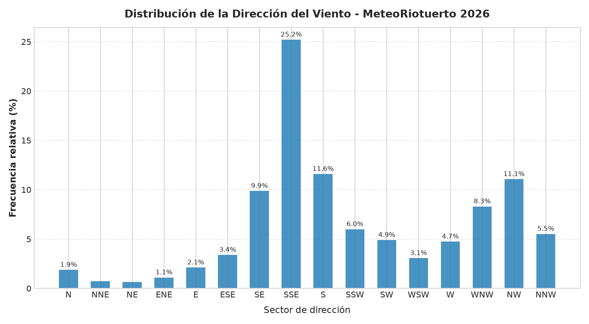
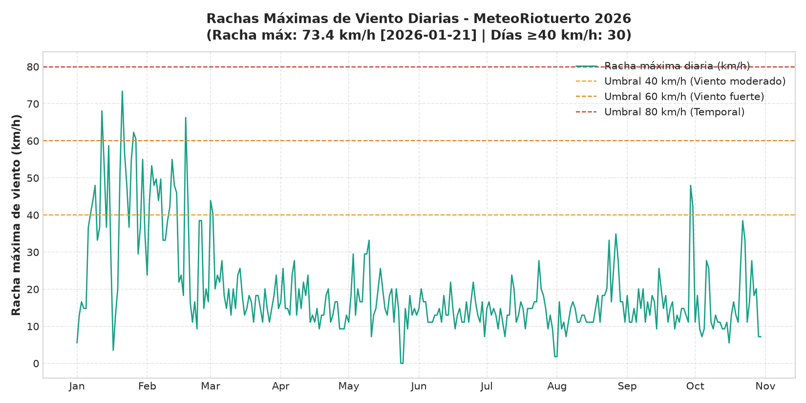
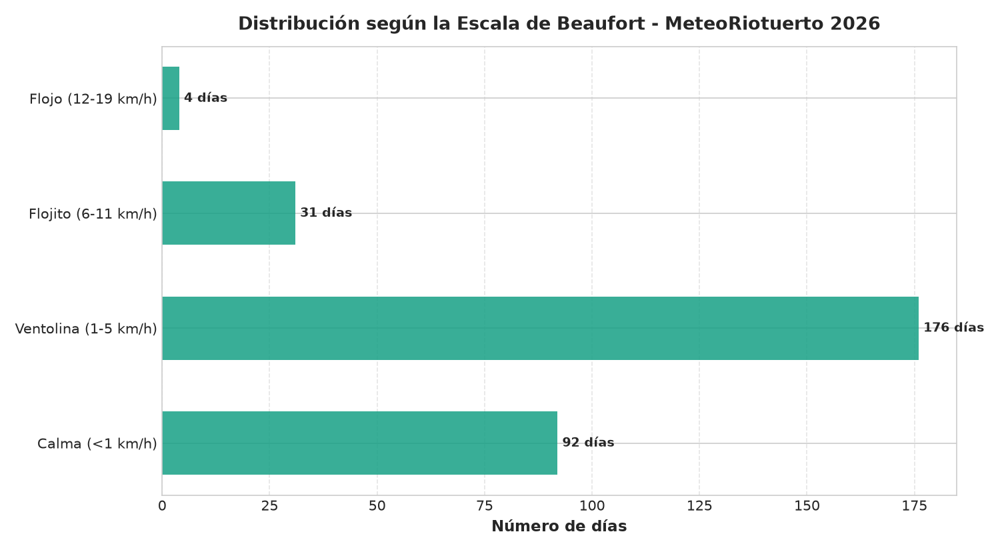

# 📅 Almanaque meteorológico 2026

**Barrio de Arriba, Riotuerto (Cantabria, España)**

> [!IMPORTANT]
> **Datos parciales y provisionales:** El año 2026 se encuentra actualmente en curso. Las estadísticas, gráficos y acumulados reflejados en este almanaque corresponden al periodo observado hasta la última actualización (2026-10-30) y tienen carácter estrictamente provisional hasta el cierre definitivo del año natural.

## 📝 Descripción sinóptica

El año 2026 en la estación meteorológica automática de Barrio de Arriba (Riotuerto) registra una temperatura media acumulada de **15.8 ºC** y una precipitación total de **1524.0 mm** distribuida en **158 días de lluvia apreciable (≥0,2 mm)**.

* **Temperaturas extremas:** La máxima absoluta alcanzó los **41.3 ºC** (2026-06-24), mientras que la mínima absoluta descendió hasta **-1.4 ºC** (2026-01-04). Se registraron **4 noches tropicales (mínima ≥20 ºC)**.
* **Régimen pluviométrico:** El día más lluvioso dejó **83.8 mm** (2026-10-07). El mes con mayor precipitación fue **Marzo** con **302.0 mm**, mientras que el más seco fue **Agosto** (56.3 mm).
* **Viento:** La racha máxima registrada fue de **73.4 km/h** (2026-01-21), con **30 días** con rachas superiores a 40 km/h.

---

## 📊 Galería visual y análisis gráfico

### 1. Dinámica termo-pluviométrica

| Climograma anual | Rango de temperaturas (Máx/Mín) |
| :---: | :---: |
|  |  |

**Calendario de precipitación y temperatura media:**

### 2. Régimen de vientos

| Radar de viento (Dirección/Velocidad) | Rosa de los vientos (Distribución) |
| :---: | :---: |
|  |  |

| Rachas máximas diarias | Frecuencia (Escala Beaufort) |
| :---: | :---: |
|  |  |

---

## 📈 Ficha estadística anual

| Categoría | Parámetro | Valor | Fecha / Notas |
| :--- | :--- | :--- | :--- |
| **🌡️ Temperaturas** | Media anual | **15.8 ºC** | |
| | Máxima absoluta | **41.3 ºC** | 2026-06-24 |
| | Mínima absoluta | **-1.4 ºC** | 2026-01-04 |
| | Media de las máximas | 21.9 ºC | |
| | Media de las mínimas | 10.9 ºC | |
| | Mayor oscilación térmica diaria | 25.2 ºC | 2026-07-06 |
| **❄️ Días de Tª** | Heladas (Mín ≤0 ºC) | 2 días | |
| | Noches tropicales (Mín ≥20 ºC) | 4 días | |
| | Noches tórridas o ecuatoriales (Mín ≥25 ºC) | 0 días | |
| | Calor (>30 ºC) | 31 días | |
| | Calor intenso (>35 ºC) | 11 días | |
| | Calor extremo (>40 ºC) | 1 días | |
| **☔ Precipitaciones** | **Acumulado total** | **1524.0 mm** | |
| | Días de lluvia (≥0,2 mm) | 158 días | |
| | Días de lluvia (≥1 mm) | 113 días | |
| | Días de lluvia (≥10 mm) | 47 días | |
| | Días de lluvia (≥30 mm) | 8 días | |
| | Máxima diaria | 83.8 mm | 2026-10-07 |
| | Mes más lluvioso | Marzo | 302.0 mm |
| | Mes más seco | Agosto | 56.3 mm |
| **💨 Viento** | Velocidad media | 2.4 km/h | |
| | Racha máxima | **73.4 km/h** | 2026-01-21 |
| | Días con rachas ≥40 km/h | 30 días | |
| **☀️ Radiación** | Radiación solar máxima | 1028.1 W/m² | Índice UV máx: 9 |

### Desglose mensual

| Mes | Tª Media (ºC) | Tª Máx (ºC) | Tª Mín (ºC) | Precipitación (mm) | Racha máx (km/h) |
| :--- | :---: | :---: | :---: | :---: | :---: |
| **Enero** | 9.3 | 20.0 | -1.4 | 195.2 | 73.4 |
| **Febrero** | 11.9 | 26.2 | 2.5 | 224.2 | 66.3 |
| **Marzo** | 10.6 | 24.4 | 1.2 | 302.0 | 43.9 |
| **Abril** | 14.2 | 31.8 | 5.7 | 71.2 | 27.7 |
| **Mayo** | 16.2 | 37.2 | 5.4 | 178.2 | 33.2 |
| **Junio** | 19.5 | 41.3 | 8.6 | 132.2 | 21.9 |
| **Julio** | 21.4 | 39.2 | 12.4 | 58.5 | 27.7 |
| **Agosto** | 20.8 | 33.3 | 11.6 | 56.3 | 34.9 |
| **Septiembre** | 18.7 | 36.2 | 9.4 | 81.7 | 48.0 |
| **Octubre** | 15.1 | 28.3 | 4.0 | 224.5 | 38.5 |
